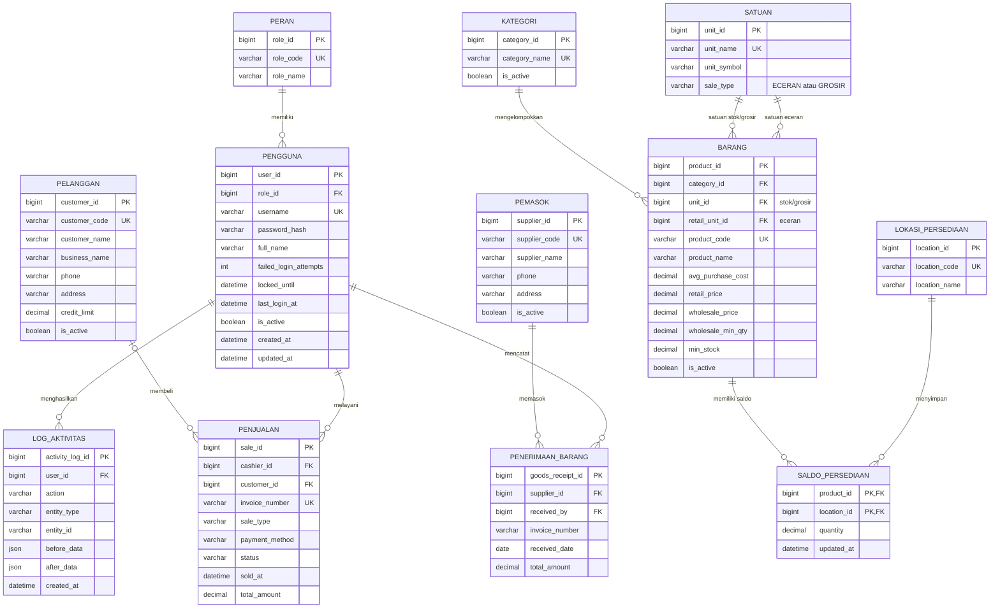
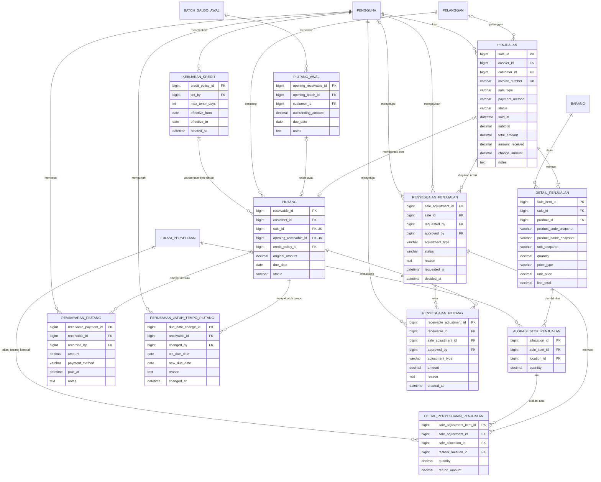
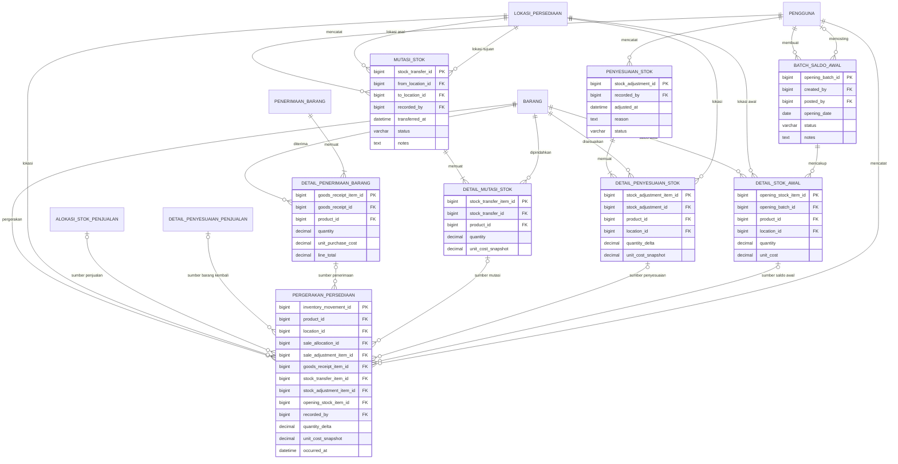
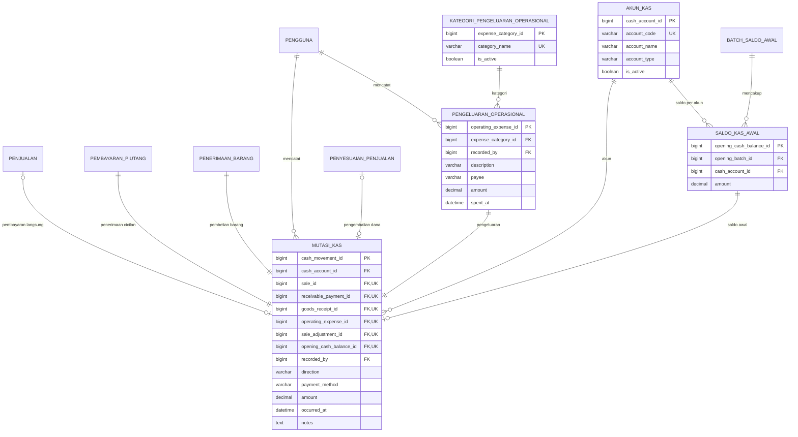

# ERD Sistem Informasi Manajemen Operasional Toko Mira Plastik

Dokumen ini menerjemahkan kebutuhan FR-01–FR-24 pada laporan menjadi rancangan basis data relasional. Diagram dibagi per domain agar dapat dibaca, tetapi seluruh diagram menggunakan entitas dan kunci yang sama.

> **Status:** acuan skema awal yang telah diperbarui mengikuti implementasi. Satuan eceran terpisah sudah ditambahkan; konversi satuan dan penerapannya di kasir masih menunggu tahap lanjutan.

## 1. Keputusan dan asumsi rancangan

Keputusan berikut digunakan pada diagram ini:

1. Satu transaksi penjualan menggunakan **satu metode pembayaran**: tunai, transfer, atau bon. Bon hanya untuk penjualan grosir. Pembayaran cicilan bon setelah transaksi dicatat sebagai pembayaran piutang.
2. Retur dapat dilakukan sebagian maupun penuh, harus disetujui Owner, dan selalu menunjuk ke alokasi stok item transaksi asal serta lokasi barang yang dikembalikan.
3. HPP menggunakan **rata-rata tertimbang bergerak**. Harga beli rata-rata diperbarui saat barang diterima; biaya per unit dibekukan pada ledger pergerakan stok agar laporan historis tidak berubah ketika harga beli berubah.
4. Saldo awal stok dan piutang dimasukkan sebagai data pembukaan yang dilacak, bukan sebagai transaksi penjualan atau penerimaan barang palsu.
5. Pembelian dari distributor dianggap dibayar saat barang diterima sesuai ruang lingkup laporan; sistem ini tidak mencatat utang kepada distributor.
6. Stok disimpan terpisah per lokasi (toko dan gudang). Penjualan grosir dapat mengambil stok dari lebih dari satu lokasi dan setiap pengambilan dicatat.
7. Barang retur yang layak jual dicatat masuk ke lokasi yang dipilih saat retur disetujui; barang rusak tidak ditambahkan ke stok jual dan dicatat sebagai penyesuaian.
8. Master satuan menandai setiap satuan sebagai `ECERAN` atau `GROSIR` melalui `sale_type`. Barang memakai satuan eceran (`retail_unit_id`) serta satuan stok/grosir (`unit_id`) yang sesuai jenis tersebut. Konversi antarsatuan dan pemakaian satuan eceran pada kasir belum diterapkan; stok tetap dicatat dalam satuan stok/grosir.

## 2. Diagram ERD

### 2.1 Data induk, pengguna, dan persediaan terkini

`SALDO_PERSEDIAAN` adalah saldo terkini untuk tampilan cepat; sumber audit dan rekonsiliasi tetap `PERGERAKAN_PERSEDIAAN` pada diagram persediaan.

### 2.2 Penjualan, retur, dan piutang

HPP per item penjualan dihitung dari total pergerakan stok keluar yang merujuk pada alokasi item tersebut. Nilai biaya per unit dibekukan dalam `PERGERAKAN_PERSEDIAAN`, sehingga laporan historis tetap konsisten ketika harga beli berubah.

### 2.3 Penerimaan, mutasi, penyesuaian, dan riwayat stok

Satu baris `DETAIL_MUTASI_STOK` menghasilkan dua pergerakan stok: pengurangan pada lokasi asal dan penambahan pada lokasi tujuan. `quantity_delta` bernilai positif untuk stok masuk dan negatif untuk stok keluar. Pada penjualan grosir, satu item dapat memiliki beberapa alokasi stok agar gudang digunakan lebih dahulu dan kekurangannya baru diambil dari toko sesuai batas stok minimum.

### 2.4 Arus kas dan pengeluaran operasional

`MUTASI_KAS` adalah buku kas/bank yang mencatat pemasukan dan pengeluaran aktual. Setiap pergerakan harus memiliki tepat satu sumber yang terisi: penjualan tunai/transfer, pembayaran piutang, penerimaan barang, pengeluaran operasional, pengembalian uang retur, atau saldo kas awal. Penjualan bon tidak membuat pemasukan sampai pembayaran piutang diterima.

## 3. Kamus data dan aturan penting

Semua kolom `*_id` menggunakan `BIGINT UNSIGNED`; jumlah barang memakai `DECIMAL(14,3)` agar satuan pecahan tetap mungkin; nilai uang memakai `DECIMAL(14,2)`; waktu kejadian memakai `DATETIME`. Terapkan foreign key, indeks, validasi, dan transaksi database untuk operasi yang mengubah lebih dari satu tabel.

| Tabel | Fungsi dan kolom penting | Kunci/aturan |
|---|---|---|
| `peran` | Daftar role: Owner, Kasir, Staf Gudang. | `role_code` unik. |
| `pengguna` | Akun, hash password, role, status aktif, jumlah gagal login, waktu kunci akun, dan waktu login terakhir. | `username` unik; akun tidak dihapus ketika sudah memiliki aktivitas; kunci 15 menit setelah 5 kegagalan login sesuai NFR-01. |
| `log_aktivitas` | Pelaku, aksi, entitas sasaran, waktu, data sebelum/sesudah dalam JSON. | Append-only; log tidak dapat diubah/dihapus oleh Kasir atau Staf Gudang. |
| `kategori`, `satuan` | Master kategori barang serta satuan yang ditandai sebagai eceran atau grosir. | Nama dan simbol satuan unik; pilihan satuan barang harus sesuai jenis satuannya. |
| `barang` | Kode/nama barang, kategori, satuan stok/grosir, satuan eceran, harga jual, harga grosir, ambang grosir, stok minimum, rata-rata biaya beli, status. | Kode unik; `unit_id` menjadi satuan stok/grosir, sedangkan `retail_unit_id` menjadi satuan eceran; konversi dan pemakaian satuan eceran di kasir masih perlu diselesaikan. |
| `lokasi_persediaan` | Lokasi persediaan, minimal `TOKO` dan `GUDANG`. | Kode lokasi unik. |
| `saldo_persediaan` | Kuantitas terkini per barang per lokasi untuk tampilan cepat. | PK gabungan (`product_id`, `location_id`); diperbarui dalam transaksi yang sama dengan ledger. |
| `pelanggan` | Identitas pelanggan grosir, kontak, plafon bon, status. | Kode unik; plafon tidak negatif. |
| `pemasok` | Identitas dan kontak distributor. | Kode unik. |
| `penjualan` | Nomor nota, kasir, tanggal, tipe eceran/grosir, metode bayar, status, total, uang diterima, kembalian, pelanggan bila bon. | Nomor nota unik; `customer_id` wajib untuk bon; bon tidak boleh untuk penjualan eceran. |
| `detail_penjualan` | Barang yang terjual, kuantitas, snapshot kode/nama/satuan, jenis harga, harga satuan, dan total baris. | Harga dan nama historis tidak berubah saat master barang berubah; HPP historis diambil dari ledger pergerakan stok. |
| `alokasi_stok_penjualan` | Jumlah dari setiap item yang diambil dari toko/gudang. | Jumlah alokasi harus sama dengan kuantitas item; tidak boleh membuat stok negatif. |
| `penyesuaian_penjualan` | Pengajuan void/retur: jenis, alasan, pemohon, status, Owner yang menyetujui/menolak, waktu. | Perubahan stok/piutang/kas hanya setelah disetujui; transaksi asal tetap disimpan. Setelah retur sebagian disetujui, gunakan retur lanjutan, bukan void atas transaksi yang sama. |
| `detail_penyesuaian_penjualan` | Alokasi stok asal, lokasi stok kembali, jumlah yang dibatalkan/diretur, dan nilai pengembalian. | Total retur per item tidak boleh melebihi kuantitas terjual dikurangi retur yang telah disetujui; barang kembali menghasilkan pergerakan stok masuk. |
| `kebijakan_kredit` | Riwayat kebijakan Owner tentang tenor maksimum bon dan periode berlakunya. | Simpan kebijakan yang berlaku ketika bon dibuat agar perubahan aturan tidak mengubah catatan lama. |
| `piutang` | Bon dan saldo pelanggan, tanggal jatuh tempo, status, serta kebijakan tenor yang digunakan. | Tepat satu sumber: `sale_id` atau `opening_receivable_id`; sumber unik; sisa = nilai awal − pembayaran − penyesuaian. |
| `pembayaran_piutang` | Cicilan/pelunasan, nilai, metode tunai/transfer, waktu, petugas. | Nilai positif; jumlah pembayaran tidak boleh melebihi saldo berjalan. |
| `perubahan_jatuh_tempo_piutang` | Riwayat perpanjangan tanggal jatuh tempo, tanggal lama/baru, alasan, Owner yang mengubah, dan waktu. | Perubahan tidak menimpa jejak tanggal sebelumnya; perubahan hanya oleh Owner. |
| `penyesuaian_piutang` | Penurunan piutang akibat retur atau write-off, alasan, persetujuan Owner. | Write-off wajib alasan dan Owner; bukan pemasukan kas. |
| `pemasok`, `penerimaan_barang` | Distributor dan penerimaan barang beserta faktur, tanggal, petugas, total pembelian. | Faktur/tanggal disimpan untuk penelusuran; sesuai ruang lingkup, nilai pembelian langsung dicatat sebagai pengeluaran. |
| `detail_penerimaan_barang` | Barang diterima, jumlah, harga beli per unit, subtotal. | Menambah stok gudang dan menjadi dasar perhitungan ulang rata-rata biaya. |
| `mutasi_stok`, `detail_mutasi_stok` | Mutasi antar lokasi dan jumlah per barang. | Lokasi asal berbeda dari tujuan; saldo asal harus cukup. Untuk proses rutin, mutasi dari gudang ke toko. |
| `penyesuaian_stok`, `detail_penyesuaian_stok` | Opname, rusak, hilang, atau koreksi; lokasi, selisih bertanda, biaya snapshot, alasan. | Alasan wajib; kerugian dihitung dari kuantitas yang hilang/rusak × biaya snapshot. |
| `pergerakan_persediaan` | Ledger pergerakan stok: barang, lokasi, selisih kuantitas, biaya snapshot, waktu, pelaku, sumber. | Ledger append-only; tepat satu kolom sumber terisi; transfer menghasilkan dua baris. |
| `akun_kas` | Akun kas dan rekening transfer. | Contoh akun: `KAS_TUNAI` dan `BANK_TRANSFER`. |
| `kategori_pengeluaran_operasional`, `pengeluaran_operasional` | Kategori dan pengeluaran operasional, jumlah, deskripsi, penerima, waktu, petugas. | Setiap pengeluaran yang telah dibayar menghasilkan satu pergerakan kas/bank. |
| `mutasi_kas` | Buku kas/bank: akun, arah, metode, nilai, waktu, petugas, sumber transaksi. | Nilai positif; tepat satu sumber terisi; pembelian langsung mengurangi akun yang dipakai. |
| `batch_saldo_awal` | Satu batch pengisian saldo awal dengan tanggal berlaku, pembuat, pemosting, status. | Setelah diposting, hanya koreksi terkontrol yang diperbolehkan. |
| `detail_stok_awal` | Jumlah dan biaya stok awal per barang/lokasi. | Posting menghasilkan pergerakan stok awal. |
| `piutang_awal` | Saldo bon yang masih terbuka saat sistem mulai digunakan. | Terhubung ke pelanggan, jumlah tersisa, dan jatuh tempo; posting membentuk piutang. |
| `saldo_kas_awal` | Saldo awal tiap akun kas/bank. | Posting menghasilkan pergerakan kas awal. |

## 4. Aturan integritas yang wajib diterapkan

1. Gunakan transaksi database saat menyimpan penjualan, alokasi stok, saldo persediaan, piutang, buku kas, dan log terkait. Jika salah satu langkah gagal, batalkan seluruh transaksi.
2. Untuk stok grosir, alokasikan dari gudang terlebih dahulu. Gunakan stok toko hanya jika kuantitas toko yang tersisa tidak melewati `min_stock`; bila tidak mencukupi, tolak transaksi sebelum pembayaran.
3. Harga grosir diterapkan pada **item** yang jumlahnya mencapai `wholesale_min_qty`; item yang tidak mencapai ambang memakai harga eceran, sesuai uraian laporan. Jenis transaksi (eceran/grosir) tetap disimpan di `penjualan`.
4. Perbarui biaya rata-rata tertimbang saat penerimaan barang diposting: `(stok sebelum × biaya rata-rata sebelum + jumlah masuk × biaya beli baru) / (stok sebelum + jumlah masuk)`. Tangani keadaan stok nol secara eksplisit.
5. Jangan menghapus transaksi yang sudah diposting. Gunakan status dan dokumen penyesuaian untuk void, retur, atau koreksi agar jejak audit tetap tersedia.
6. Batasi tanggal jatuh tempo bon agar tidak melewati tenor maksimum pada kebijakan yang berlaku ketika bon dibuat. Perhitungan plafon pelanggan menggunakan saldo berjalan dari piutang yang belum lunas.
7. Buat foreign key dengan kebijakan `RESTRICT` untuk data master yang telah dipakai transaksi; gunakan penonaktifan (soft delete) daripada penghapusan fisik.
8. `saldo_persediaan` adalah cache yang harus selalu konsisten dengan jumlah `pergerakan_persediaan`. Lakukan rekonsiliasi berkala dan sediakan prosedur koreksi melalui penyesuaian yang memiliki alasan.
9. Laporan laba/rugi menghitung pendapatan, HPP dari snapshot biaya barang terjual, biaya operasional, kerugian stok, dan write-off piutang. Hindari mengurangi pembelian barang sebagai biaya sekaligus dengan HPP; pembelian masuk sebagai stok dan arus kas keluar, sementara HPP diakui ketika barang terjual.
10. Arsip bulanan sebaiknya merupakan filter atas transaksi dan ledger historis, bukan salinan tabel yang menjadi sumber data kedua. File backup/restore adalah urusan operasional/infrastruktur dan tidak perlu disimpan sebagai entitas ERD bisnis.
11. Pastikan semua perubahan data penting mencatat pelaku dan waktu pada `log_aktivitas`, termasuk perubahan harga, stok, persetujuan, pembayaran piutang, dan transaksi kas.

## 5. Poin yang harus disamakan dengan laporan sebelum diagram disahkan

- Laporan menyebut pencatatan transaksi manual sekitar **5 menit**, tetapi target transaksi sistem di kebutuhan nonfungsional adalah **maksimal 1 menit**. Pertahankan keduanya sebagai baseline dan target yang berbeda.
- Pastikan kebijakan retur uang untuk transaksi tunai/transfer dan pembatalan bon disetujui Owner. ERD mencatat refund dan penyesuaian piutang secara terpisah.
- Tetapkan jumlah dan satuan stok minimum per barang serta contoh hitung ambang grosir pada data nyata.
- Pastikan saldo awal stok, bon pelanggan, dan kas dicatat serta direkonsiliasi sebelum sistem dipakai operasional.
- Ketentuan “pembelian distributor dibayar saat barang diterima” harus disetujui karena pencatatan utang pemasok dinyatakan di luar ruang lingkup.

## 6. Pemetaan kebutuhan laporan

| Kebutuhan | Entitas utama |
|---|---|
| FR-01–FR-05: login, role, akun, log, backup | `peran`, `pengguna`, `log_aktivitas`; backup dikelola pada infrastruktur |
| FR-06–FR-07: data barang | `barang`, `kategori`, `satuan` |
| FR-08–FR-12: transaksi, pelanggan, void/retur | `penjualan`, `detail_penjualan`, `alokasi_stok_penjualan`, `pelanggan`, `penyesuaian_penjualan`, `detail_penyesuaian_penjualan` |
| FR-13–FR-15: bon, pembayaran, jatuh tempo, write-off | `piutang`, `pembayaran_piutang`, `penyesuaian_piutang`, `piutang_awal` |
| FR-16–FR-20: stok, penerimaan, distributor, mutasi, penyesuaian | `lokasi_persediaan`, `saldo_persediaan`, `pergerakan_persediaan`, `pemasok`, `penerimaan_barang`, `detail_penerimaan_barang`, `mutasi_stok`, `detail_mutasi_stok`, `penyesuaian_stok`, `detail_penyesuaian_stok` |
| FR-21: arus kas operasional | `akun_kas`, `mutasi_kas`, `pengeluaran_operasional`, `kategori_pengeluaran_operasional` |
| FR-22–FR-24: laporan, arsip, laba/rugi | Sumber dari `penjualan`, item HPP, penerimaan, kas, persediaan, penyesuaian, dan write-off; tidak memerlukan salinan tabel laporan sebagai sumber utama |

## 7. Saran penerapan pada laporan

Letakkan subbab ERD setelah analisis kebutuhan/proses bisnis dan sebelum rancangan detail sistem. Apabila diagram terlalu padat, gunakan empat gambar per domain pada Bagian 2. Beri keterangan gambar seperti **“Entity Relationship Diagram Sistem Informasi Manajemen Operasional Terintegrasi Toko Mira Plastik”**, lalu cantumkan aturan utama dan asumsi sebagai narasi di bawahnya.
